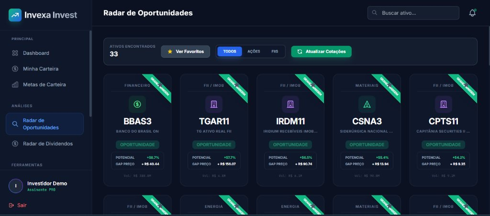
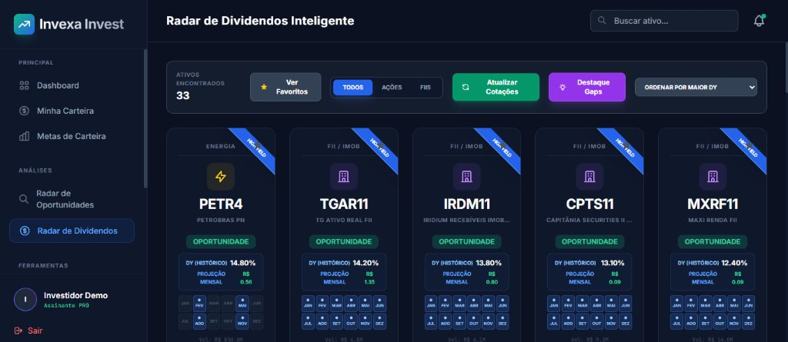
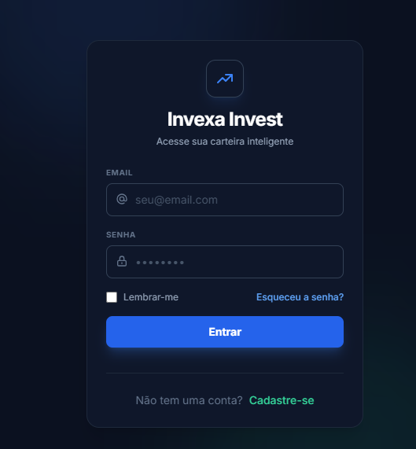

# 📈 Invexa Invest

> **Plataforma Inteligente de Gestão de Carteira, Screener Fundamentalista e Análise de Investimentos (Ações e FIIs da B3).**

[](https://www.python.org/)
[](https://fastapi.tiangolo.com/)
[](LICENSE)
[](Dockerfile)
[](render.yaml)

---

## 💡 Sobre o Invexa Invest

O **Invexa Invest** é uma plataforma moderna desenvolvida para simplificar a jornada de investidores de ações e fundos imobiliários (FIIs) no mercado financeiro brasileiro. Ele combina gestão inteligente de patrimônio, ferramentas automáticas de rebalanceamento, acompanhamento de proventos e screener com indicadores fundamentalistas em tempo real.

---

## 📸 Demonstração Visual das Telas

### 🔍 Radar de Oportunidades (Benjamin Graham & Margem de Segurança)
Filtro de ações e FIIs descontados na B3 com cálculo automático de Preço Justo e Potencial de Alta:
<p align="center">
  
</p>

### 💰 Radar de Dividendos Inteligente (Histórico & Projeções)
Acompanhamento dos melhores ativos pagadores de proventos com DY histórico, projeção de renda passiva mensal e matriz de meses de pagamento:
<p align="center">
  
</p>

### 🔐 Autenticação Segura & Design Dark Moderno
Interface minimalista, fluida e responsiva estilizada com Tailwind CSS:
<p align="center">
  
</p>

---

## ✨ Funcionalidades Principais

### 1. 📊 Dashboard Patrimonial Completo
- Visão geral do patrimônio total, rentabilidade acumulada e variação diária.
- Gráficos interativos em **Chart.js** com distribuição percentual por classe de ativos e setor.
- Histórico e evolução de dividendos recebidos mês a mês.

### 2. 🎯 Rebalanceamento Inteligente de Carteira
- Definição de metas percentuais por ativo ou classe de ativo.
- Sugestão automática de novos aportes para manter a carteira alinhada aos objetivos do investidor sem necessidade de vender ativos (evitando custos e tributação desnecessária).

### 3. 🔍 Screener Fundamentalista & Radar de Dividendos
- Filtro avançado de Ações e FIIs por múltiplos:
  - **P/L** (Preço / Lucro)
  - **P/VP** (Preço / Valor Patrimonial)
  - **Dividend Yield (DY)** dos últimos 12 meses
  - **ROE**, **ROIC**, Margens e Liquidez Diária
- **Radar de Dividendos Inteligente**: Identificação de empresas boas pagadoras de proventos históricos e ativos descontados.

### 4. 🧮 Ferramentas de Análise & Valuation
- **Valuation Décio Bazin**: Cálculo de Preço Teto baseado em Dividend Yield desejado (6% ou customizado).
- **Valuation Benjamin Graham**: Fórmula do valor intrínseco $\sqrt{22.5 \times \text{LPA} \times \text{VPA}}$.
- **Calculadora de Juros Compostos**: Simulação de aportes mensais, taxas e prazos.
- **Calculadora FIRE**: Planejamento para independência financeira e renda passiva.
- **Comparador de Ativos**: Comparativo lado a lado de indicadores entre múltiplos ativos.
- **Agenda de Dividendos**: Calendário com as próximas datas com ("Data Com") e datas de pagamento.

### 5. 💳 Gestão de Assinaturas & Mercado Pago
- Planos **Gratuito** e **Premium** (Mensal e Anual).
- Integração nativa com **Mercado Pago Checkout Pro** e processamento via Webhooks.
- Painel Administrativo para controle de usuários e planos.

---

## 🛠️ Tecnologias Utilizadas

| Camada | Tecnologias |
| :--- | :--- |
| **Backend** | Python 3.12+, FastAPI, Uvicorn, SQLAlchemy, Pydantic v2 |
| **Frontend** | Jinja2 Templates, Tailwind CSS (Dark Mode), Chart.js, Vanilla JS |
| **Autenticação** | JWT (JSON Web Tokens) com `python-jose` e hashing `bcrypt` |
| **Banco de Dados** | SQLite (desenvolvimento local) / PostgreSQL (produção) |
| **Mercado & Dados** | Integrações com Brapi e scrapers com fallback |
| **Infraestrutura** | Docker, Render.com (`render.yaml`) |

---

## 📁 Estrutura do Repositório

```plaintext
invexa2-main/
│
├── .venv/                      # Ambiente virtual Python
├── app/                        # Núcleo da aplicação
│   ├── api/routes/             # Endpoints (auth, views, portfolio, assets, payments, etc.)
│   ├── core/                   # Configurações (config.py, database.py, templates.py)
│   ├── models/                 # Modelos SQLAlchemy (user, asset, portfolio, dividend, etc.)
│   ├── schemas/                # Schemas Pydantic para validação de dados
│   ├── services/               # Lógica de negócio, Valuation e serviços de mercado
│   ├── static/                 # Arquivos estáticos (CSS, JS, imagens)
│   └── templates/              # Templates Jinja2 organizados por tela
│
├── docs/                       # Documentações adicionais (Deploy, manuais)
│   ├── DEPLOY_RENDER.md
│   └── img/                    # Capturas de tela e imagens do README
│       ├── login_screen.png
│       ├── radar_dividendos.jpg
│       └── radar_oportunidades.jpg
│
├── scripts/                    # Scripts utilitários de sistema
│   ├── check_db.py
│   ├── cleanup.py              # Limpeza de portas antes de iniciar o servidor
│   ├── debug/                  # Scripts e dumps auxiliares de depuração
│   ├── migrations/             # Migrações manuais e ajustes de esquema
│   └── seeds/                  # Carga de ativos da B3 (Ações e FIIs)
│
├── tests/                      # Scripts de teste de rotas e verificações de APIs
│
├── Dockerfile                  # Imagem Docker para deploy em nuvem
├── render.yaml                 # Configuração Blueprint para o Render.com
├── requirements.txt            # Dependências do projeto
└── run.bat                     # Inicializador automático para Windows (.venv)
```

---

## 🚀 Como Executar Localmente

### 🔑 Credenciais de Acesso (Demonstração / Testes)

O sistema conta com usuários de demonstração pré-configurados no banco de dados para login imediato:

| Perfil | E-mail | Senha | Benefícios / Acesso |
| :--- | :--- | :--- | :--- |
| **Investidor Demo** | `demo@invexa.com` | `demo123` | **Plano Premium Ativo** (Valuation, Radar, Rebalanceamento e Proventos) |
| **Administrador** | `admin@invexa.com` | `admin123` | **Admin Completo** + Painel de Gerenciamento (`/admin`) |

> 💡 *Dica:* Você também pode criar novas contas a qualquer momento diretamente pela tela de cadastro (`/register`). Se precisar restaurar as credenciais demo, execute:
> ```bash
> python scripts/seeds/seed_demo_users.py
> ```

---

### Pré-requisitos
* **Python 3.11** ou **Python 3.12** instalado na máquina.
* Git instalado.

### Método 1: Inicialização Automática no Windows (Recomendado)
Basta dar um duplo clique no arquivo **`run.bat`** (ou executá-lo no terminal):

```cmd
run.bat
```

O `run.bat` realiza automaticamente:
1. Detecção ou criação do ambiente virtual **`.venv`**;
2. Instalação e checagem das dependências do `requirements.txt`;
3. Limpeza de processos prévios nas portas padrão;
4. Inicialização do servidor Uvicorn com hot-reload ativo.

Acesse no navegador: **[http://localhost:8000](http://localhost:8000)**

---

### Método 2: Inicialização Manual

1. **Clone o repositório:**
   ```bash
   git clone https://github.com/SEU_USUARIO/invexa-invest.git
   cd invexa-invest
   ```

2. **Crie e ative o ambiente virtual `.venv`:**
   * **No Windows:**
     ```cmd
     python -m venv .venv
     .venv\Scripts\activate
     ```
   * **No Linux/macOS:**
     ```bash
     python3 -m venv .venv
     source .venv/bin/activate
     ```

3. **Instale as dependências:**
   ```bash
   pip install -r requirements.txt
   ```

4. **Popule a base com os ativos iniciais da B3 (Opcional):**
   ```bash
   python scripts/seeds/seed_market.py
   ```

5. **Inicie o servidor:**
   ```bash
   uvicorn app.main:app --host 127.0.0.1 --port 8000 --reload
   ```

---

## ☁️ Deploy em Produção (Render.com)

O repositório já inclui os arquivos prontos [`Dockerfile`](Dockerfile) e [`render.yaml`](render.yaml) configurados para implantação com banco de dados **PostgreSQL**.

Para o guia detalhado passo a passo de deploy, consulte a documentação em:
👉 **[Guia de Deploy no Render](docs/DEPLOY_RENDER.md)**

---

## 🤝 Contribuições

Contribuições são bem-vindas! Sinta-se à vontade para abrir uma *Issue* ou enviar um *Pull Request*:
1. Faça um Fork do projeto
2. Crie uma branch para sua funcionalidade (`git checkout -b feature/nova-funcionalidade`)
3. Faça o commit de suas alterações (`git commit -m 'Adiciona nova funcionalidade'`)
4. Faça o push para a branch (`git push origin feature/nova-funcionalidade`)
5. Abra um Pull Request

---

## ☕ Apoie o Projeto / Doações

Se este projeto foi útil para os seus estudos, investimentos ou desenvolvimento, você pode apoiar a manutenção e novas melhorias enviando qualquer valor em criptomoedas para a carteira abaixo:

### 💎 Carteira Cripto :
```text
0x1c4E87f67Eb42a72F562d242f518b0F31DDa2688
```

> **Redes suportadas:** Ethereum (ETH), Binance Smart Chain (BNB / BEP-20), Polygon (POL/MATIC), Arbitrum, Optimism, Avalanche C-Chain e Base.

*Agradecemos imensamente o apoio à comunidade de código aberto!* 🚀

